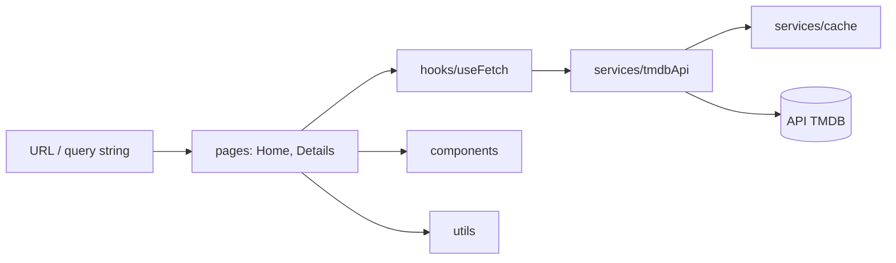

# Avaliação de arquitetura e engenharia — Movies

> Data: 30/10/2026 · Base: branch `fix/ci-filtros-env` (PR #45) · Complementa `docs/ANALISE.md`, de 27/09/2026.

## 1. Resumo

O desenho é adequado ao tamanho do projeto: uma SPA pequena, em camadas, com dependência em um único sentido. Os problemas estão nas bordas: entradas da URL sem validação, falhas sem tratamento, dependências sem uso e um pipeline que mistura verificação e publicação.

As notas abaixo são julgamento técnico a partir do código, dos testes e do CI. Elas não incluem uso real: a versão de 28/09 nunca foi publicada e ainda não foi testada contra a API real.

## 2. Evidências coletadas

| Item | Resultado |
|---|---|
| Código em `src/` | 26 arquivos JS e CSS, 2.377 linhas |
| Testes | 34 passando em 7 suítes |
| Cobertura | 88,5% de instruções, 83,2% de ramos, 80,6% de funções |
| ESLint (`react-app`) | Sem avisos, mas não roda no CI |
| CI do PR #45 | Verde, em 44 s |
| `npm audit --omit=dev` | 48 alertas (2 críticos, 21 altos), quase todos herdados do `react-scripts` |
| Dependências sem uso | `classnames`, `sass` e `web-vitals` (nenhuma importação em `src/`); `gh-pages` duplica o deploy do workflow |

## 3. Arquitetura

**O que está bem resolvido**

- Dependência em um só sentido: tela → hook → serviço. Nenhuma tela chama `fetch`.
- A URL é a fonte de verdade dos filtros, o que permite compartilhar um link.
- `AbortController` elimina a corrida entre buscas.
- Erros tipados (`TmdbError`) permitem que cada tela decida a mensagem.
- Cache simples, com limite de memória e sem dependência nova.

**Dívidas de arquitetura**

| ID | Dívida | Impacto | Decisão |
|---|---|---|---|
| A1 | Create React App sem manutenção | Origem da maior parte dos alertas; build lento | Migrar para Vite em ciclo próprio |
| A2 | `HashRouter` | Limita SEO e links limpos | Manter enquanto o site estiver no GitHub Pages |
| A3 | Chave no JavaScript publicado e no histórico do Git | Qualquer pessoa pode usá-la e consumir a cota | Risco aceito pelo responsável (ADR-006) |
| A4 | CSS global, com classes como `.navbar` e `.title-text` usadas por páginas diferentes | Mudar uma página pode afetar a outra | CSS Modules junto com a migração |
| A5 | JavaScript sem tipos | O contrato da TMDB só existe na documentação | TypeScript gradual, começando pelo serviço |
| A6 | Filtros seguem de estado para URL, sem o caminho inverso | Editar a URL com a Home aberta não atualiza a tela | Corrigir ao extrair um hook de filtros |

## 4. Engenharia: defeitos encontrados

| ID | Severidade | Onde | Defeito | Efeito para quem usa |
|---|---|---|---|---|
| E1 | Alta | `src/index.js` | Sem rota para endereços desconhecidos | Página em branco, só com o rodapé |
| E2 | Alta | `src/index.js` | Sem Error Boundary | Um erro de renderização apaga a tela inteira |
| E3 | Média | `pages/Home` | `page` da URL sem validação (`-1`, `2.5`, `9999`) | A TMDB rejeita a página e a tela mostra erro |
| E4 | Média | `services/tmdbApi` | JSON inválido escapa do `TmdbError` | Mensagem técnica em inglês na tela |
| E5 | Média | `services/tmdbApi` | HTTP 401 tratado como falha comum | "Tentar novamente" para uma chave recusada, que nunca vai funcionar |
| E6 | Baixa | `services/tmdbApi` | `id` da rota entra no caminho sem codificação | Um endereço forjado pode chamar outro endpoint da TMDB |
| E7 | Baixa | `pages/Details` | Sem o marco `<main>` | Pior navegação por leitor de tela |
| E8 | Alta | `ci.yml` | Publicação também por push em `developer-mvp` | Uma branch de integração sobrescreve a produção |
| E9 | Média | `ci.yml` | Permissão de escrita em todos os jobs, inclusive nos de PR | Privilégio maior que o necessário |
| E10 | Média | `ci.yml` | `CI: false` no build, `--passWithNoTests` e sem lint | Avisos e ausência de testes não bloqueiam a entrega |
| E11 | Média | `package.json` | Dependências sem uso; ferramentas de teste e build em `dependencies` | Mais superfície de ataque e manutenção |
| E12 | Baixa | `package.json` | Nome `Movie's` é inválido para o npm; `react-router-dom` com alerta moderado | Ferramentas podem rejeitar o pacote |

## 5. Notas (0 a 10)

| Critério | Nota | Justificativa |
|---|---|---|
| Separação de responsabilidades | 8 | Camadas claras; a Home ainda acumula filtros, URL e renderização |
| Confiabilidade | 6 | Erros de rede tratados; E1 a E5 em aberto |
| Segurança | 4 | Chave exposta, com risco aceito; workflow com permissão ampla |
| Testes | 7 | Boa cobertura de unidade; sem E2E e sem limite mínimo no CI |
| Pipeline | 5 | Rápido e automático; verificação e publicação misturadas |
| Dependências | 3 | CRA sem manutenção e 48 alertas |
| Manutenibilidade | 6 | Código pequeno e legível; sem tipos e com CSS global |
| Documentação | 7 | Boa e detalhada; ainda descrevia a arquitetura como "alvo" |

**Média: 5,8 / 10.** Metas e resultado em `docs/PLANO-ESTRATEGICO.md`.
